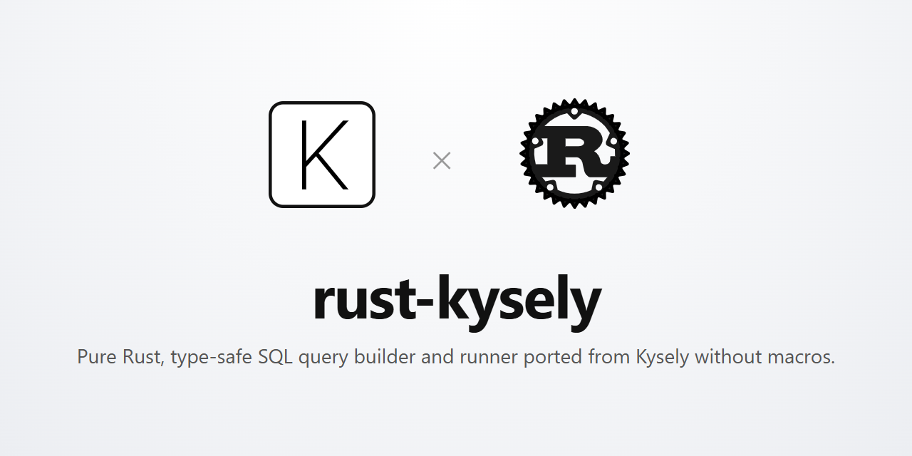

<div align="center">
  
</div>

<br/>

# rust-kysely Documentation

<div align="center">

[](https://github.com/leandroluk/rust-kysely/actions/workflows/ci.yml)
[](https://crates.io/crates/rust-kysely)
[](https://docs.rs/rust-kysely)
[](LICENSE-MIT)
[](#)
[-orange.svg)](#)

**Pure Rust, type-safe, fluent SQL query builder and execution engine faithfully ported from Kysely (TypeScript).**

</div>

---

## Highlights

- **100% Macro-Free**: Zero procedural macros (`syn`, `quote`, `proc-macro` are completely absent). Clean, instant compilation without compiler bloat.
- **Pure Rust AST**: Immutable, copy-on-write Operation Node trees (`OperationNode`) representing queries, mutations, clauses, expressions, and DDL.
- **Multi-Dialect Architecture**: Production-grade compilers, introspectors, and adapters for **PostgreSQL**, **MySQL**, **MSSQL (SQL Server)**, **SQLite**, and **PGlite**.
- **First-Class Migrations**: Complete transactional migrator supporting `migrate_to_latest()`, `migrate_down()`, `migrate_to()`, with safe concurrency locks (PostgreSQL Advisory Locks, `sp_getapplock`, `GET_LOCK`).
- **Extensible Plugin Pipeline**: Intercept and transform query ASTs and execution results with `CamelCasePlugin`, `DeduplicateJoinsPlugin`, `WithSchemaPlugin`, or your own custom plugins.
- **Strict Footprint Discipline**: Compact string optimizations via `compact_str::CompactString` and small-vector stack allocations via `smallvec::SmallVec`.

---

## Quickstart

Add `rust-kysely` to your `Cargo.toml`:

```toml
[dependencies]
rust-kysely = { version = "0.1", features = ["postgres"] }
tokio = { version = "1.0", features = ["full"] }
```

### Fluent Query Building

```rust
use rust_kysely::dialect::postgres::PostgresDialect;
use rust_kysely::prelude::*;

#[tokio::main]
async fn main() -> Result<(), Box<dyn std::error::Error>> {
    // 1. Initialize Kysely with a Postgres Dialect
    let dialect = PostgresDialect::from_connection_string("host=localhost user=postgres dbname=app")?;
    let db = Kysely::new(dialect);

    // 2. Build and execute a SELECT query
    let users = db
        .select_from("users")
        .select(["id", "name", "email"])
        .where_("is_active", "=", true)
        .where_("age", ">=", 18)
        .order_by("created_at", "DESC")
        .limit(10)
        .execute()
        .await?;

    for row in users.rows {
        let name: String = row.get("name")?;
        let email: String = row.get("email")?;
        println!("User: {} <{}>", name, email);
    }

    Ok(())
}
```

---

## Why rust-kysely?

TypeScript's [Kysely](https://kysely.dev) is revered for its incredible developer experience, type-safety, and intuitive query builder without the overhead and black-box surprises of full ORMs.

In the Rust ecosystem:
- Traditional ORMs like **Diesel** or **SeaORM** rely heavily on heavyweight procedural macros (`derive`, complex macro DSLs) that balloon build times and create opaque compiler errors.
- Raw query runners like **SQLx** provide compile-time verification but lack dynamic composition, runtime plugins, schema introspection, and cross-dialect portability.

`rust-kysely` bridges this gap: it brings the **exact architecture of Kysely** to Rust with **zero macros**, type-safe builders, clean async traits, and native compilation speeds.

---

## TypeScript Kysely vs Rust Kysely

| Concept | TypeScript Kysely | `rust-kysely` (Pure Rust) |
| :--- | :--- | :--- |
| **`WHERE` filtering** | `.where('age', '>=', 18)` | `.filter("age", ">=", 18)` *(or `.r#where(...)` / `.where_(...)`)* |
| **AST Tree** | `OperationNode` (JS plain objects) | `OperationNode` enum with `Cow<'static, str>` & `SmallVec` |
| **Query Builders** | `SelectQueryBuilder<DB, TB, O>` | `SelectQueryBuilder<T>` (builder pattern) |
| **Raw SQL** | `sql\`SELECT ${x}\`` template literal | `sql("SELECT ").append(x)` via `RawBuilder` |
| **Expression Builder** | `eb => eb.and([...])` | `ExpressionBuilder::new()` or `eb.and(...)` closures |
| **Plugins** | `KyselyPlugin` interface | `#[async_trait] pub trait KyselyPlugin: Send + Sync` |
| **Drivers** | `Driver` with `acquireConnection()` | `#[async_trait] pub trait Driver: Send + Sync` |
| **Advisory Locks** | PostgreSQL `pg_advisory_lock` (CRC32/FNV) | `3853314791062309107` (exact 64-bit Kysely migration lock) |
| **Dialects** | Postgres, MySQL, MSSQL, SQLite, Libsql | Postgres, MySQL, MSSQL, SQLite, PGlite |

> [!NOTE]
> **Why `.filter(...)` instead of `.where(...)`?**  
> In Rust, `where` is a reserved keyword utilized by the compiler for generic trait bounds (e.g., `fn foo<T>() where T: Clone`).  
> `rust-kysely` provides **`.filter(...)`** as the idiomatic, ergonomic Rust standard (following Rust iterator and ORM conventions). For strict 1:1 parity with SQL, the raw identifier **`.r#where(...)`** and the trailing-underscore alias **`.where_(...)`** are also fully supported across all query builders.

---

## Architecture Blueprint

```text
+-----------------------------------------------------------+
|                       Kysely Instance                     |
+-----------------------------------------------------------+
         |                       |                     |
         v                       v                     v
  +--------------+        +--------------+      +--------------+
  | QueryBuilder |        | SchemaModule |      |   Migrator   |
  +--------------+        +--------------+      +--------------+
         |                       |                     |
         +-----------------------+---------------------+
                                 |
                                 v
                       +-------------------+
                       |   OperationNode   | (AST Tree)
                       +-------------------+
                                 |
            +--------------------+--------------------+
            | (Pre-compilation)                       | (Compilation)
            v                                         v
   +-----------------+                       +-----------------+
   |  KyselyPlugin   |                       |  QueryCompiler  |
   | (e.g. CamelCase)|                       | (Postgres/MySQL)|
   +-----------------+                       +-----------------+
            |                                         |
            +--------------------+--------------------+
                                 v
                       +-------------------+
                       |   CompiledQuery   | (SQL + Parameters)
                       +-------------------+
                                 |
                                 v
                       +-------------------+
                       |   QueryExecutor   |
                       +-------------------+
                                 |
                                 v
                       +-------------------+
                       |      Driver       | (Database Connection)
                       +-------------------+
```
